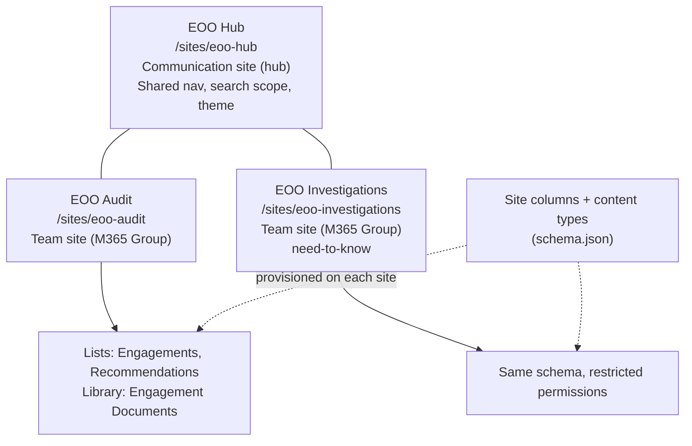
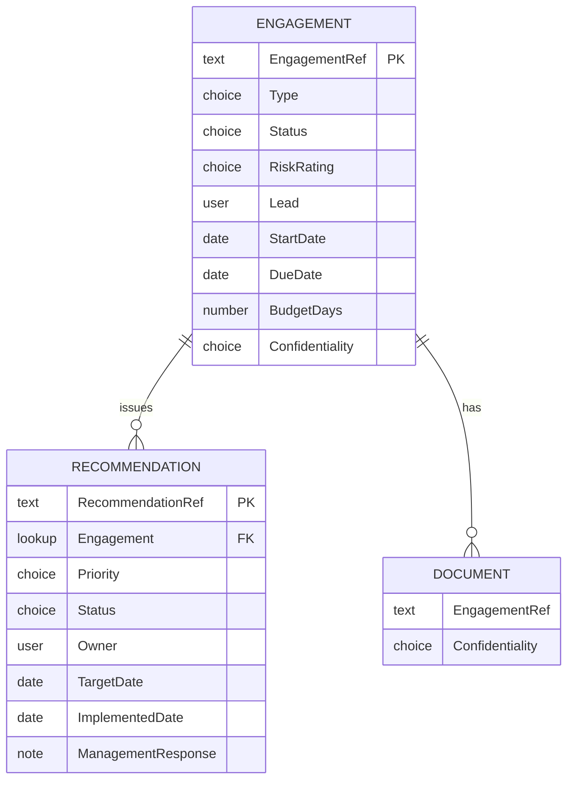

# Information Architecture and Design Decisions

> **Self-directed portfolio project.** "Example Oversight Office" (EOO) is fictional. Provisioning scripts are **syntax-checked only and have not been tested on a live Microsoft 365 tenant**.

## 1. Site topology

| Site | Template | Purpose | Audience |
|---|---|---|---|
| EOO Hub | Communication site, registered as hub | Landing page, cross-team navigation, rolled-up search and (later) web parts | All office staff (read) |
| EOO Audit | Team site | Audit/inspection/advisory engagements | Audit staff; others read |
| EOO Investigations | Team site | Investigation case tracking | Investigations staff only |

## 2. Data model

Full definitions: [`provisioning/templates/schema.json`](../provisioning/templates/schema.json). All internal names carry an `EOO` prefix.

## 3. Design decisions

| # | Decision | Why | Trade-off |
|---|---|---|---|
| D1 | **Site columns and content types**, not per-list columns | Reusable, one definition changed in one place; content types make "what is an Engagement" explicit and enable search/roll-up across sites | Slightly more setup; changing published content types needs care |
| D2 | **Hub site + two team sites** instead of one big site | Separate permission boundaries (Investigations is need-to-know), separate lifecycle and storage, shared navigation through the hub | More sites to govern |
| D3 | **Team sites (M365 Group-connected)** for Audit/Investigations | Teams/Planner/Graph integration (needed for the My Tasks web part) | Group membership is a second place to manage access |
| D4 | **Deterministic column IDs** (hash of name) | Same column ID on every site: cross-site search, re-runs are idempotent, future site-script/ALM friendliness | IDs are not "random"; renaming a column internal name changes the ID |
| D5 | **Declarative schema (JSON) + thin PowerShell** | Reviewable in a pull request; the script contains logic, the JSON contains the design | Custom format instead of the standard PnP XML template |
| D6 | **Recommendation → Engagement as a lookup** (not a copied ref) | Referential integrity and a clickable link | Lookups don't cross sites, so recommendations live with their engagement |
| D7 | **Choice columns** for status/priority | Enforced vocabulary, usable in views, easy to chart | Adding a value is a schema change |
| D8 | **"Overdue" is computed in views/code**, not a stored status | A stored "Overdue" goes stale overnight; `[Today]` in CAML is always correct | Charts must compute it themselves |
| D9 | **Unique permissions on lists**; lists inherit nothing from the site | Least privilege made explicit; a site-level permission change can't silently widen list access | Needs governance; unique ACLs have limits (~50k scoped items; here only 3 lists) |
| D10 | **Custom permission level "Contribute (No Delete)"** for staff | Engagement records must not be deletable by contributors (audit trail); only Owners can delete | Users may ask "why can't I delete" |
| D11 | **Versioning on** (50 major versions) | Audit trail of changes to engagement records and working papers | Storage |
| D12 | **Engagement Documents** uses a separate non-unique `EOODocEngagementRef` | A uniqueness constraint copied to the library would block more than one document per engagement | Duplicate concept (documented here) |

## 4. Permissions model (summary)

| Scope | Owners | Members | Visitors |
|---|---|---|---|
| Hub | Hub admins (Full Control) | – | All office staff (Read) |
| Audit lists/library | Full Control | Contribute (No Delete) | Read |
| Investigations lists/library | Full Control | Contribute (No Delete) | **No access** (group removed) |

Details and rationale are in the (upcoming) security document. Groups should contain **security groups**, not individual users, in a real deployment.

## 5. Navigation
- Hub top navigation: Home, Audit, Investigations (shared by all associated sites).
- Team sites: Engagements, Recommendations, Engagement Documents.

## 6. Not covered here (planned)
Retention labels / records management, sensitivity labels, and a seed-data script are documented later (security doc, module 7).
